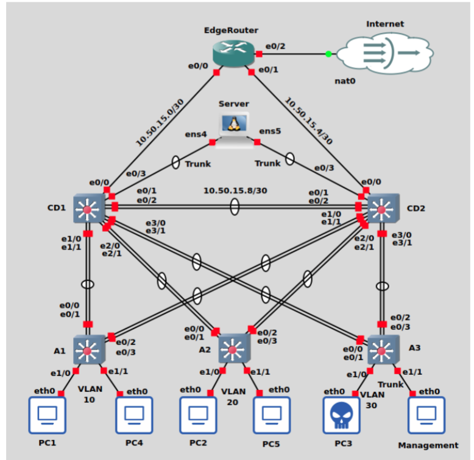

# 2024118471_2024116801-RDS1
# Redes de Computadores I — Projeto Prático 2026/2027

**Universidade Fernando Pessoa**  
**Docente:** Pedro Sobral  
**Ano letivo:** 2026/2027

---

## 1. Sobre o Projeto

Este repositório contém o desenvolvimento do projeto prático da unidade curricular de **Redes de Computadores I**, no âmbito do ano letivo 2026/2027.

O projeto consiste na implementação de uma infraestrutura de rede empresarial, recorrendo ao GNS3 e a equipamentos Cisco, seguindo uma arquitetura baseada em *Routed Core / Layer 3 Distribution*.

Nesta primeira fase, o trabalho centra-se na preparação da infraestrutura, montagem da topologia e configuração dos principais mecanismos de comutação Layer 2.

São abordados os seguintes componentes:

- Segmentação da rede através de VLANs;
- Configuração de ligações Trunk IEEE 802.1Q;
- Agregação de ligações através de EtherChannel e LACP;
- Spanning Tree Protocol (Rapid-PVST+);
- Configuração de PortFast e BPDU Guard;
- Planeamento do endereçamento IPv4 através de VLSM.

## 2. Topologia da Rede

A infraestrutura segue uma arquitetura hierárquica, organizada em três camadas funcionais:

- **Access Layer:** switches A1, A2 e A3, responsáveis pela ligação dos dispositivos finais.
- **Distribution / Core Layer:** switches multilayer CD1 e CD2, responsáveis pela distribuição e encaminhamento do tráfego.
- **Edge Layer:** EdgeRouter, responsável pela ligação à rede externa.

A topologia contempla ainda um servidor Debian e vários dispositivos finais, incluindo computadores de utilizadores e um computador destinado à gestão da infraestrutura.



*Figura 1 — Topologia da infraestrutura de rede definida no enunciado.*

## 3. Equipamentos da Infraestrutura

| Equipamento | Identificação | Função |
|---|---|---|
| Router | EdgeRouter | Ligação à Internet |
| Switch Multilayer | CD1 | Distribuição e encaminhamento |
| Switch Multilayer | CD2 | Distribuição e encaminhamento |
| Switch de acesso | A1 | Ligação de dispositivos finais |
| Switch de acesso | A2 | Ligação de dispositivos finais |
| Switch de acesso | A3 | Ligação de dispositivos finais |
| Servidor | Debian | Serviços centralizados |
| Computadores | PC1–PC5 | Dispositivos clientes e auditoria |
| Computador | Management PC | Gestão da infraestrutura |

## 4. Segmentação da Rede

A infraestrutura utiliza quatro VLANs para separar os diferentes grupos de dispositivos.

| VLAN | Nome | Dispositivos | Hosts necessários |
|---:|---|---|---:|
| 10 | Guest | PC1 e PC4 | 60 |
| 20 | Student | PC2 e PC5 | 120 |
| 30 | Staff / Server | PC3 e Debian Server | 30 |
| 99 | Management | Equipamentos de rede e Management PC | 14 |

Esta segmentação permite organizar a rede, separar os diferentes grupos de utilizadores e facilitar a aplicação de políticas de comunicação e segurança nas fases seguintes.

## 5. Configurações da Primeira Fase

### 5.1. VLANs

Criação e configuração das VLANs 10, 20, 30 e 99 nos switches, com associação das portas de acesso aos respetivos segmentos.

### 5.2. Trunking

Configuração das ligações Trunk através do padrão IEEE 802.1Q, permitindo transportar tráfego de várias VLANs entre equipamentos.

### 5.3. EtherChannel — LACP

Agregação de ligações físicas entre os switches de acesso e de distribuição, utilizando LACP para criar ligações lógicas e aumentar a disponibilidade da infraestrutura.

### 5.4. Spanning Tree Protocol

Configuração de Rapid-PVST+ para prevenir ciclos na camada Layer 2.

A distribuição das Root Bridges prevista no enunciado é:

| Switch | Root Primary | Root Secondary |
|---|---|---|
| CD1 | VLAN 10 e 30 | VLAN 20 e 99 |
| CD2 | VLAN 20 e 99 | VLAN 10 e 30 |

Nas portas de acesso deverão ser configurados PortFast e BPDU Guard.

### 5.5. Endereçamento IPv4

O bloco de endereçamento disponibilizado pelo enunciado é:

`10.50.0.0/20`

Será utilizado VLSM (*Variable Length Subnet Mask*) para distribuir os endereços IP de acordo com as necessidades de cada VLAN.

As sub-redes e respetivas máscaras serão documentadas durante o planeamento do endereçamento.

## 6. Checklist — Primeira Fase

A seguinte checklist permite acompanhar o desenvolvimento do trabalho e identificar as tarefas concluídas e pendentes.

### 6.1. Preparação da infraestrutura

- [ ] Criar e guardar o projeto no GNS3.
- [x] Adicionar a topologia ao repositório GitHub.
- [ ] Adicionar e configurar todos os equipamentos no GNS3.
- [ ] Estabelecer as ligações entre os switches de distribuição e acesso.
- [ ] Estabelecer as ligações ao EdgeRouter.
- [ ] Ligar o servidor Debian aos switches CD1 e CD2.
- [ ] Verificar o arranque dos equipamentos.

### 6.2. Configuração Layer 2

- [x] Criar e configurar as VLANs.
- [ ] Confirmar a associação das portas às VLANs corretas.
- [ ] Configurar as ligações Trunk 802.1Q.
- [x] Configurar os Port-Channels.
- [ ] Confirmar o funcionamento do LACP.
- [x] Configurar PortFast.
- [ ] Configurar BPDU Guard.
- [ ] Configurar Rapid-PVST+.
- [ ] Definir CD1 e CD2 como Root Primary e Root Secondary, de acordo com as VLANs.
- [ ] Validar o funcionamento do Spanning Tree.

### 6.3. Planeamento do endereçamento

- [ ] Identificar os requisitos de hosts de cada VLAN.
- [ ] Calcular as sub-redes utilizando VLSM.
- [ ] Definir as máscaras de rede.
- [ ] Identificar os intervalos de endereços disponíveis.
- [ ] Definir os endereços de rede e broadcast.
- [ ] Documentar a tabela de endereçamento IPv4.
- [ ] Verificar se não existem sobreposições entre sub-redes.

### 6.4. Documentação e GitHub

- [x] Adicionar a imagem da topologia (`topologia.png`).
- [ ] Documentar as configurações realizadas.
- [ ] Guardar as configurações dos switches.
- [ ] Registar evidências dos testes efetuados.
- [ ] Atualizar o README.md.
- [ ] Fazer commit das alterações.
- [ ] Enviar as alterações para o GitHub.

*Nota: as tarefas assinaladas como concluídas correspondem ao trabalho já identificado no histórico do repositório. As restantes devem ser marcadas apenas depois de verificadas.*

## 7. Testes e Validação

Após as configurações, deverão ser realizados testes para confirmar o funcionamento da infraestrutura.

| Componente | Comando de verificação |
|---|---|
| VLANs | `show vlan brief` |
| Trunks | `show interfaces trunk` |
| EtherChannel | `show etherchannel summary` |
| Spanning Tree | `show spanning-tree` |
| Interfaces | `show interfaces status` |

Os resultados e as respetivas capturas de ecrã poderão ser guardados na pasta `documentation/evidence/`.

## 8. Estrutura do Repositório

```text
2024118471_2024116801-RDS1/
│
├── README.md
├── topologia.png
├── .gitignore
│
└── ProjetoRedes-2024118471_2024116801/
    └── ...
```

A organização interna poderá ser desenvolvida à medida que forem sendo adicionadas configurações, documentação e evidências ao projeto.

## 9. Resultado Esperado

No final da primeira fase, pretende-se ter a infraestrutura preparada no GNS3, com os equipamentos interligados, as VLANs configuradas, os Port-Channels implementados e os mecanismos de Spanning Tree devidamente configurados e validados.

Deverá também estar concluído o planeamento inicial do endereçamento IPv4 através de VLSM, acompanhado da respetiva documentação.

---

**Redes de Computadores I**  
Universidade Fernando Pessoa  
Ano letivo 2026/2027
